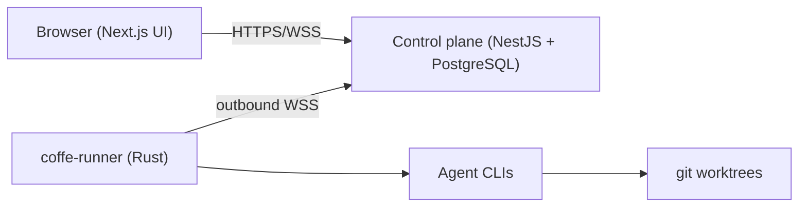

# COFFE

Web platform for orchestrating native agentic coding CLIs (Claude Code, Codex, Gemini CLI,
OpenCode, Antigravity, Grok Build, Muse Code, Pi, Kiro) for software teams:
**Plan → Assign → Build → Review**, in the browser, shared by a team.

COFFE never calls model APIs. Agents run inside each CLI on a **runner** — a small Rust daemon on a
developer machine or team VM that connects *outbound* to the control plane and is the only
component that touches repositories, CLIs, Docker, databases and SSH hosts.



- Architecture, protocol, data model, security: [docs/architecture.md](docs/architecture.md)
- Phase run instructions and status: `docs/phase-*.md`

## Repository layout

| Path | What |
|---|---|
| `apps/web` | Next.js App Router UI (no business logic) |
| `apps/api` | NestJS control plane: REST `/api/v1`, Better Auth `/api/auth`, WebSockets `/api/ws`, `/api/runner` |
| `packages/protocol` | TS types + validators generated from `crates/coffe-protocol` |
| `packages/contracts` | REST + realtime zod contracts shared by api and web |
| `crates/coffe-protocol` | Runner ↔ control plane protocol (single source of truth) |
| `crates/coffe-adapters` | `CliAdapter` trait + one adapter per CLI |
| `crates/coffe-runner` | Runner daemon and CLI |
| `crates/coffe-fake-cli` | Fake agent CLI used by tests and demos |
| `deploy` | Docker Compose, Caddyfile, Dockerfiles |
| `e2e` | Playwright end-to-end suite |

## Prerequisites (development)

- Node.js ≥ 22.12 (26 LTS recommended) and pnpm 12 (`npm i -g pnpm@12`)
- Rust 1.100 (`rust-toolchain.toml` installs it via rustup)
- Docker (development PostgreSQL)
- git ≥ 2.38 on runner machines

## Quick start (development)

```bash
pnpm install
docker compose -f deploy/docker-compose.dev.yml up -d      # PostgreSQL on :55432
cp apps/api/.env.example apps/api/.env                       # then edit AUTH_SECRET
pnpm build
pnpm dev                                                     # api :4000, web :3000
cargo build --release -p coffe-runner
```

Open http://localhost:3000, sign up, create a workspace, then **Runners → Pair a runner** and run
the displayed command on the machine that has your repositories and CLIs:

```bash
coffe-runner pair --server http://localhost:4000 --token coffe_pt_…
coffe-runner repo add ~/code/my-project
coffe-runner start
```

## Self-hosting

```bash
cp deploy/.env.example deploy/.env    # DOMAIN, AUTH_SECRET, POSTGRES_PASSWORD, CADDY_TLS
docker compose -f deploy/docker-compose.yml --env-file deploy/.env up -d --build
```

## Tests

| Layer | Command |
|---|---|
| Rust (protocol, adapters, runner, fake CLI) | `cargo build -p coffe-fake-cli && cargo test --workspace` |
| TypeScript units + API integration | `pnpm test` (needs the dev PostgreSQL) |
| End-to-end | `pnpm test:e2e` |
| Protocol drift | `pnpm protocol:check` |
