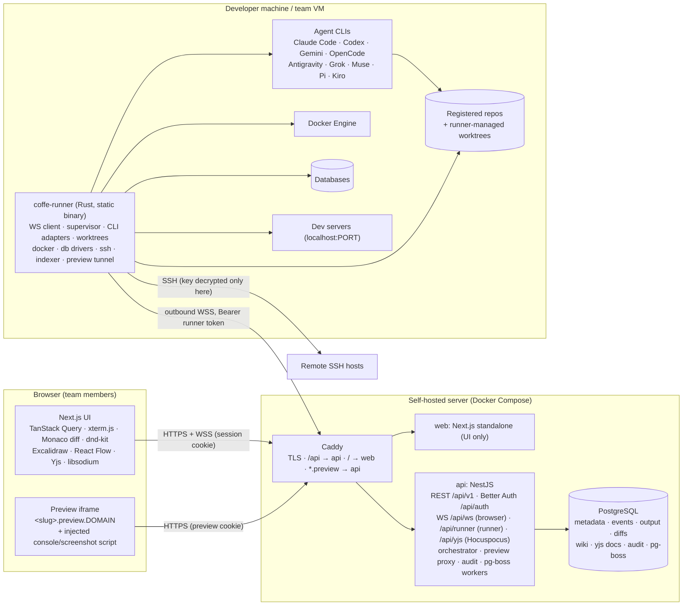
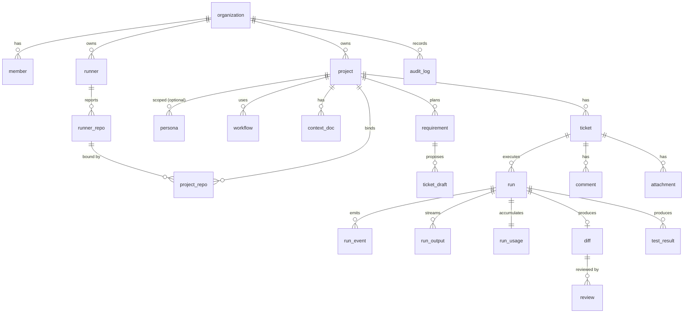
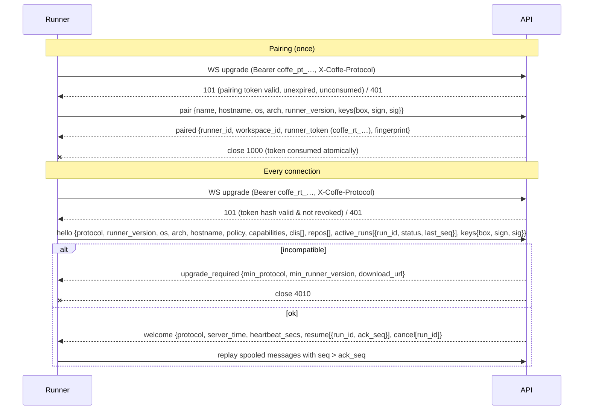
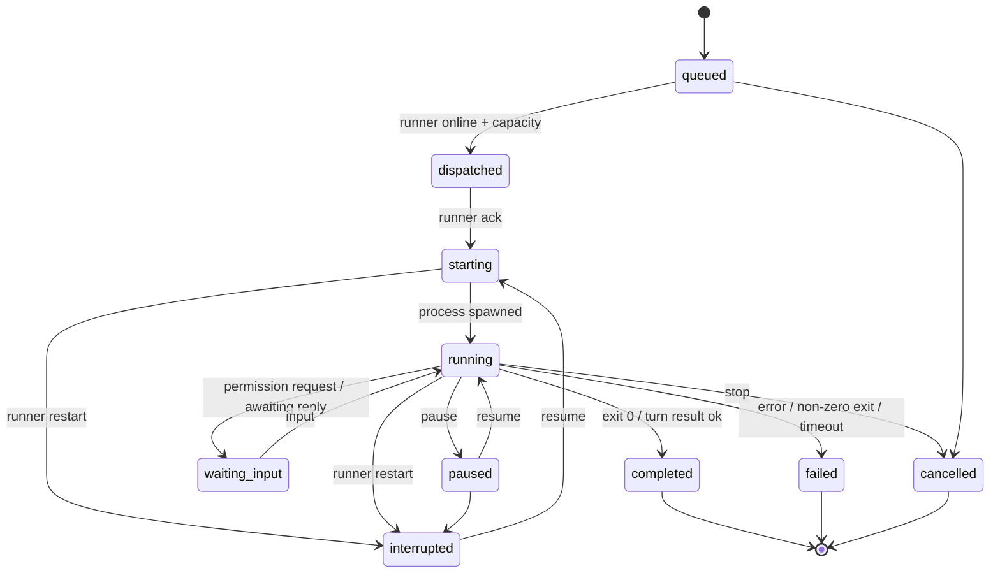

# COFFE — Architecture

Status: v1 · 2026-11-16 · source of truth for all phases. A change to the protocol, data model,
adapter interface or security model MUST update this document in the same change.

COFFE is a web platform that orchestrates native agentic coding CLIs for software teams.
Workflow (parity target: Sokudo): **Plan → Assign → Build → Review**. Sokudo is a desktop IDE;
COFFE runs entirely in the browser and is shared by a team.

---

## 1. Principles

1. **Orchestrate, never replace.** Every model interaction happens inside a vendor CLI running on a
   runner, under that machine's existing CLI login/subscription. The control plane never calls a
   model API and never holds model credentials. Planning, wiki generation, query assistance and
   canvas iteration are CLI runs too.
2. **Three parts, one direction.** Web (display/control) → control plane (state, coordination,
   relay) → runner (every local effect). The runner dials out over WebSocket; nothing dials in.
3. **The control plane stores metadata, never code or secrets.** It persists logs, terminal output,
   agent events, diffs, usage, generated docs and audit records. File contents (review, citations)
   are fetched from the runner on demand and relayed without persistence. Secrets travel sealed to
   a runner public key.
4. **Human gate.** Nothing is merged or pushed without an explicit, audited human approval.
5. **Boring, single instance first.** One API process, one PostgreSQL, no Redis. The data model is
   multi-workspace so a hosted version stays possible; no billing or tenant isolation now.

Non-goals now: billing, horizontal API scaling, native Windows runner (WSL first), mobile UI.

---

## 2. Component diagram



| Path | Carries | Persisted by control plane |
|---|---|---|
| runner → api | run state, terminal bytes, agent events, usage, diffs, test results, code graph, container logs | yes |
| runner → api | file contents (review, citations), query results, preview HTTP traffic | **no** — relayed only |
| browser → api | user actions, terminal input, sealed secrets | sealed SSH secrets: ciphertext only; sealed DB credentials: relayed only |
| api → runner | commands (`run.start`, `git.merge`, …) | every command audited |

---

## 3. Repository layout

```
coffe/
├─ apps/
│  ├─ web/                Next.js App Router — UI only, no API routes
│  └─ api/                NestJS control plane (REST, WS gateways, jobs, Drizzle schema + migrations)
├─ packages/
│  ├─ protocol/           generated TS types + Ajv validators for the runner protocol (do not hand-edit generated.ts)
│  ├─ contracts/          REST + browser-realtime DTOs (zod) shared by api and web
│  └─ tsconfig/           shared tsconfig bases
├─ crates/
│  ├─ coffe-protocol/     runner protocol types (serde + schemars) — SINGLE SOURCE OF TRUTH
│  ├─ coffe-adapters/     CliAdapter trait, one adapter per CLI, event normalization
│  ├─ coffe-runner/       runner daemon + `coffe-runner` CLI
│  ├─ coffe-fake-cli/     fake agent CLI fixture (tests + demo)
│  ├─ coffe-docker/       P3 container management (bollard)
│  ├─ coffe-db/           P3 pluggable DB drivers
│  ├─ coffe-ssh/          P3 SSH client (russh)
│  └─ coffe-indexer/      P4 tree-sitter code indexer
├─ e2e/                   Playwright suite (boots api + web + runner + fake CLI)
├─ deploy/                docker-compose.yml, Caddyfile, Dockerfiles, .env.example
├─ docs/                  architecture.md, phase-N.md, cli-support.md, runbooks
├─ Cargo.toml             Cargo workspace (+ [workspace.dependencies])
├─ package.json · pnpm-workspace.yaml · turbo.json · biome.json
└─ rust-toolchain.toml
```

---

## 4. Technology and versions

Verified 2026-11-16 against the npm registry (`dist-tags.latest`, `modified`), the crates.io API
(`max_stable_version`, `updated_at`) and Docker Hub. "Maintained" = a release within ~12 months
and no archive/deprecation notice. Pinned exactly in manifests; Renovate-style bumps are manual.

### 4.1 Runtime and tooling

| Item | Version | Notes |
|---|---|---|
| Node.js | **26 LTS** (26.13.1, "Lithium") in images (`node:26-alpine`); local dev ≥ 22.12 | NestJS 12 needs ≥ 22.12; Vitest 5 needs ^22.12 \|\| ≥ 24 |
| pnpm | 12.21.0 (`packageManager` field; pnpm ≥ 9.7 self-switches) | |
| Turborepo | 2.11.11 | `turbo.json` `tasks` |
| TypeScript | **6.0.3** — deviation, see §19 D3 | 7.0.2 is latest but ships no programmatic compiler API |
| Biome | 2.6.8 | lint + format (one tool instead of ESLint + Prettier) |
| Rust | 1.100.0 (`rust-toolchain.toml`); edition 2024 | |
| PostgreSQL | 18 (`postgres:18-alpine`) | |
| Caddy | 2.11.9 (`caddy:2.11-alpine`) | |
| git (runner host) | ≥ 2.38 | `merge-tree --write-tree` |

### 4.2 Web app

| Package | Version | Maintained | Notes |
|---|---|---|---|
| next | 16.4.6 | yes | App Router, Turbopack; UI only |
| react / react-dom | 19.3.1 | yes | |
| tailwindcss / @tailwindcss/postcss | 4.3.5 | yes | CSS-first config |
| shadcn (CLI) + radix-ui | 4.23.0 / 1.8.1 | yes | components copied into `apps/web/src/components/ui` |
| lucide-react · sonner · next-themes | 1.73.0 · 2.0.8 · 0.4.6 | yes · yes · slow (stable, shadcn default) | |
| class-variance-authority · clsx · tailwind-merge · tw-animate-css | 0.7.1 · 2.1.1 · 3.7.0 · 1.4.0 | stable | shadcn peers |
| @tanstack/react-query | 5.107.1 | yes | server state |
| @xterm/xterm + addon-fit / web-links / search | 6.0.0 + 0.11.0 / 0.12.0 / 0.16.0 | yes (6.0.0 released 2026-11-16) | no React wrapper needed |
| @monaco-editor/react + monaco-editor | 4.7.0 + 0.57.0 | yes | `DiffEditor`; monaco served from our origin (no CDN) |
| @dnd-kit/react + @dnd-kit/helpers | 0.5.3 | yes | deviation from classic `@dnd-kit/core` 6.3.1 (no release since 2024-12), §19 D4 |
| @excalidraw/excalidraw | 0.18.1 | yes | React 19 peer OK |
| @xyflow/react + @dagrejs/dagre | 12.12.1 + 3.1.3 | yes | graph + layered layout |
| yjs · y-protocols · @hocuspocus/provider | 13.6.33 · 1.0.7 · 4.8.0 | yes | Yjs 14 is beta; `y-excalidraw` rejected (no release since 2024-12) |
| libsodium-wrappers | 0.8.4 | yes | standard build contains `crypto_box_seal`, `crypto_pwhash` (argon2id13), `crypto_sign_verify_detached`, `crypto_generichash` (verified in `dist/`) |
| @zumer/snapdom | 3.7.6 | yes (most active of modern-screenshot / html-to-image / html2canvas) | preview screenshots |
| zod · react-hook-form · @hookform/resolvers | 4.6.7 · 7.92.0 · 7.0.6 | yes | |
| react-markdown + remark-gfm | 10.1.0 + 4.0.1 | slow, stable (unified) | wiki / context rendering |
| fractional-indexing | 4.0.0 | yes | Kanban ordering |

### 4.3 Control plane

| Package | Version | Maintained | Notes |
|---|---|---|---|
| @nestjs/core · common · platform-express · testing | 12.5.0 | yes | ESM packages; Standard Schema (`@Body({ schema })`) validation with zod |
| @nestjs/config | 12.1.1 | yes | zod `validationSchema` |
| ws | 8.23.0 | yes | raw `WebSocketServer({ noServer: true })`, §19 D2 |
| drizzle-orm / drizzle-kit | 0.45.4 / 0.31.11 | yes | 1.0 is still RC |
| pg | 8.23.1 | yes | node-postgres pool (shared by Drizzle, Better Auth, pg-boss) |
| pg-boss | 12.38.2 | yes | jobs + cron in Postgres |
| better-auth (+ CLI package `auth`) | 1.7.25 | yes | organization plugin; `@better-auth/cli` is deprecated → `auth` |
| @hocuspocus/server | 4.8.0 | yes | Yjs server embedded in the api |
| ajv / ajv-formats | 8.20.0 / 3.0.1 | yes / stable | runner-frame validation from the generated schema |
| nestjs-pino / pino / pino-http | 5.3.1 / 10.4.0 / 11.0.0 | yes | |

### 4.4 Tests

| Package | Version |
|---|---|
| vitest / @vitest/coverage-v8 | 5.1.0 |
| @playwright/test | 1.65.1 |
| @testing-library/react / jsdom | 16.3.3 / 31.0.1 |
| supertest | 7.3.2 |
| unplugin-swc + @swc/core | 2.0.0 + 1.16.22 (decorator metadata in Vitest) |
| json-schema-to-typescript | 16.0.0 (protocol codegen) |

### 4.5 Runner (Rust crates)

| Crate | Version | Maintained | Use |
|---|---|---|---|
| tokio · tokio-util · tokio-stream · futures | 1.54.1 · 0.7.20 · 0.1.19 · 0.3.34 | yes | runtime |
| tokio-tungstenite + rustls (ring provider) + webpki-roots | 0.30.0 + 0.23.46 + 1.0.12 | yes | outbound WSS, no OpenSSL |
| portable-pty | 0.9.0 | slow (last crate release 2025-02; wezterm repo active) | PTY on Linux/macOS (+ ConPTY for dev on Windows); §18 R17 |
| serde · serde_json · schemars | 1.0.229 · 1.0.154 · 1.2.3 | yes | protocol + JSON Schema |
| dryoc | 2.0.0 | yes | libsodium-compatible `crypto_box_seal`, `crypto_sign` (Ed25519), `crypto_generichash`, `crypto_secretbox` in pure Rust |
| keyring | 4.2.0 | yes | OS keychain for the local store key |
| clap · tracing · tracing-subscriber · anyhow · thiserror | 4.6.7 · 0.1.44 · 0.3.23 · 1.0.104 · 2.0.21 | yes | |
| uuid · time · base64 · sha2 · hex · rand · directories · toml · which | 1.29.2 · 0.3.55 · 0.23.1 · 0.11.1 · 0.4.3 · 0.10.4 · 6.0.0 · 1.2.1 · 8.0.6 | yes / stable | |
| tempfile · assert_cmd · predicates | 3.27.0 · 2.2.2 · 3.1.4 | yes | tests |
| bollard | 0.21.1 | yes | P3 Docker |
| russh | 0.65.1 | yes | P3 SSH |
| sqlx (postgres, mysql, sqlite-bundled) · mongodb · redis · clickhouse | 0.9.0 · 3.10.1 · 1.8.2 · 0.15.3 | yes | P3 DB drivers |
| tree-sitter · tree-sitter-tags + grammars (typescript 0.23.2, javascript 0.25.0, python 0.25.0, go 0.25.0, rust 0.24.2, java 0.23.5) | 0.27.2 | yes (grammars: stable) | P4 indexer |
| ignore · notify · notify-debouncer-full | 0.4.34 · 8.2.2 · 0.7.0 | yes | P4 indexer + change detection |

### 4.6 Agent CLIs (targets; detected, never installed by COFFE)

| CLI | Binary | Latest seen | Package / source |
|---|---|---|---|
| Claude Code | `claude` | 2.1.325 | `@anthropic-ai/claude-code` |
| OpenAI Codex | `codex` | 0.169.0 | `@openai/codex` |
| Gemini CLI | `gemini` | 0.68.0 | `@google/gemini-cli` |
| OpenCode | `opencode` | 2.3.0 (V2, `@opencode/cli`); 1.19.5 (V1, `opencode-ai`) | anomalyco/opencode |
| Google Antigravity CLI | `agy` | 1.5.9 | google-antigravity/antigravity-cli |
| xAI Grok Build | `grok` | 1.0.77 | `@xai-official/grok` |
| Meta Muse Code | `muse` | 1.4.18 | dev.meta.ai |
| Pi | `pi` | 1.5.2 | `@earendil-works/pi-coding-agent` |
| Kiro CLI | `kiro-cli` | 3.3.0 | kiro.dev |

---

## 5. Data model

Conventions: PostgreSQL + Drizzle ORM, `snake_case`, domain ids `uuid` (UUIDv7 generated in the
app), Better Auth tables keep their `text` ids, `workspace_id` = Better Auth `organization.id`
(`text`). All timestamps `timestamptz`. Every domain row is reachable from exactly one workspace.



### 5.1 Identity and workspaces (Better Auth, generated schema)

`user`, `session`, `account`, `verification`, `organization` (= workspace), `member`
(`role ∈ owner | member | reviewer`), `invitation`. Session carries `activeOrganizationId`.

### 5.2 Runners and repositories

| Table | Columns (key ones) |
|---|---|
| `runner_pairing_tokens` | id, workspace_id, token_hash (sha256), label, created_by, expires_at (10 min), consumed_at, runner_id |
| `runners` | id, workspace_id, name, hostname, os, arch, runner_version, protocol_version, token_hash (unique), token_prefix, box_public_key, sign_public_key, box_key_signature, fingerprint, status (`online`/`offline`/`revoked`), last_seen_at, max_concurrent_runs, capabilities jsonb, policy jsonb, created_by, created_at, revoked_at |
| `runner_clis` | runner_id, cli_id, path, version, auth_status, capabilities jsonb, detected_at — PK(runner_id, cli_id) |
| `runner_repos` | id, runner_id, repo_key (runner-generated stable id), name, path (display only), default_branch, remote_url (credentials stripped), head_commit, missing, reported_at — UNIQUE(runner_id, repo_key) |
| `project_repos` | id, project_id, runner_id, runner_repo_id, is_primary, created_at — several runners per project |

### 5.3 Projects, personas, context, workflows

| Table | Columns |
|---|---|
| `projects` | id, workspace_id, name, slug, key (ticket prefix, e.g. `COF`), description, ticket_seq, default_workflow_id, settings jsonb (`test_command`, `merge_strategy` ff/merge/squash, `push_on_approve`, `remote`, `auto_advance`, `pricing_overrides`), created_by, timestamps, archived_at |
| `personas` | id, workspace_id, project_id (null = workspace-wide), name, role (`planner`/`implementer`/`tester`/`reviewer`/`designer`/`custom`), instructions, cli_id, model, permissions jsonb (§10.5), color, created_by, timestamps, archived_at |
| `workflows` | id, workspace_id, project_id (nullable), name, steps jsonb `[{key, name, persona_ids[], parallel, on_fail: "stop"\|"goto:<key>", max_loops}]`, is_default |
| `context_docs` | id, project_id, kind (`rule`/`knowledge`), title, body (markdown), enabled, position, updated_by, timestamps |

### 5.4 Planning, tickets, runs

| Table | Columns |
|---|---|
| `requirements` | id, project_id, title, body, status (`draft`/`planning`/`review`/`approved`/`failed`), planner_persona_id, planning_run_id, created_by, timestamps |
| `ticket_drafts` | id, requirement_id, position, title, description, acceptance_criteria jsonb (string[]), suggested_role, estimate, depends_on jsonb (draft positions), status (`pending`/`approved`/`discarded`), ticket_id |
| `tickets` | id, project_id, number, key, title, description, acceptance_criteria jsonb, status (`backlog`/`ready`/`in_progress`/`in_review`/`done`), position (fractional index), priority, assignee_persona_id, workflow_id, requirement_id, branch, base_branch, worktree_runner_id, flags jsonb (`failed`, `blocked`, `merge_conflict`), created_by, timestamps — UNIQUE(project_id, number) |
| `ticket_dependencies` | ticket_id, depends_on_id |
| `runs` | id, workspace_id, project_id, ticket_id (null for non-ticket runs), kind (`ticket`/`planning`/`wiki`/`query_assist`/`canvas`), persona_id, workflow_step_key, attempt, parent_run_id, runner_id, cli_id, model, mode (`structured`/`pty`), status (§11.1), status_detail, exit_code, prompt, cli_session_id, worktree_path, branch, base_commit, head_commit, result_summary, last_seq, requested_by, created_at, started_at, ended_at |
| `run_events` | run_id, seq, ts, type, data jsonb — PK(run_id, seq) |
| `run_output` | run_id, seq, ts, data bytea — PK(run_id, seq); retention-pruned |
| `run_usage` | run_id PK, input_tokens, output_tokens, cache_read_tokens, cache_write_tokens, reasoning_tokens, total_tokens, cost_usd numeric(14,6), cost_source (`reported`/`estimated`/`unavailable`), duration_ms, model, updated_at |

### 5.5 Review

| Table | Columns |
|---|---|
| `diffs` | id, run_id, ticket_id, base_commit, head_commit, stats jsonb, files jsonb `[{path, old_path, status, additions, deletions, binary}]`, patch text (≤ 2 MiB), truncated, created_at |
| `test_results` | id, run_id, ticket_id, source (`command`/`agent`), command, status (`passed`/`failed`/`error`), passed, failed, skipped, duration_ms, report jsonb, output_tail, created_at |
| `reviews` | id, ticket_id, diff_id, run_id, reviewer_id, decision (`approved`/`changes_requested`), body, created_at |
| `merges` | id, ticket_id, review_id, strategy, target_branch, merge_commit, pushed, status, error, created_at |
| `comments` | id, workspace_id, target_type (`ticket`/`diff`), target_id, file_path, line, side (`old`/`new`), body, author_id, timestamps, resolved_at |
| `attachments` | id, workspace_id, project_id, ticket_id, kind (`screenshot`/`canvas_export`/`image`/`console_log`/`file`), mime, size_bytes, data bytea (≤ 10 MiB), created_by, created_at |
| `audit_logs` | id bigserial, workspace_id, ts, actor_type (`user`/`runner`/`agent`/`system`), actor_user_id, runner_id, persona_id, run_id, action, target_type, target_id, command, details jsonb, ip, user_agent |

### 5.6 Phase 3 tables

| Table | Columns |
|---|---|
| `docker_environments` | id, project_id, name, image, build jsonb (`dockerfile`, `context`), command, env jsonb (non-secret only), ports jsonb, mount_worktree, scope (`project`/`ticket`), created_at |
| `containers` | id, environment_id, ticket_id, runner_id, container_id, name, status, ports jsonb, timestamps |
| `previews` | id, project_id, ticket_id, runner_id, slug (unique, 128-bit random), name, target jsonb (`port`, optional `container_id`), status, created_by, created_at, expires_at |
| `ssh_hosts` | id, workspace_id, name, hostname, port, username, host_key_fingerprint (display; runner pins its own), created_by, created_at |
| `ssh_credentials` | id, ssh_host_id, runner_id, sealed bytea (crypto_box_seal), public_key_fingerprint, created_by, created_at — UNIQUE(ssh_host_id, runner_id) |
| `user_vaults` | user_id PK, kdf jsonb (`argon2id13`, salt, opslimit, memlimit), check_nonce, check_box |
| `vault_items` | id, user_id, kind, ref_id, nonce, ciphertext, created_at |

Database connections and their credentials are **not** in the control plane (requirement 14):
they live only in the runner's local encrypted store.

### 5.7 Phase 4 tables

| Table | Columns |
|---|---|
| `canvases` | id, project_id, title, doc_name (Yjs), thumbnail_attachment_id, created_by, timestamps |
| `ticket_canvases` | ticket_id, canvas_id |
| `yjs_documents` | name PK, state bytea, updated_at |
| `wiki_pages` | id, project_id, slug, title, position, body_md, citations jsonb `[{id, path, start_line, end_line, commit}]`, source_commit, status (`fresh`/`stale`/`generating`/`failed`), generated_by_run_id, updated_at |
| `code_graphs` | id, project_id, runner_repo_id, commit, nodes jsonb, edges jsonb, stats jsonb, created_at |

Runner-local state (never in the control plane): `runner.toml`, runner token, box/sign secret
keys, DB connections + credentials, SSH known-hosts pins, repo registry, run journals and spools.

---

## 6. Control plane (NestJS)

### 6.1 Modules

| Module | Responsibility |
|---|---|
| `AuthModule` | Better Auth (`toNodeHandler`) mounted at `/api/auth/*` before the JSON body parser; `SessionGuard` (`auth.api.getSession`), `@CurrentSession()`, workspace membership + role guard (§19 D1) |
| `WorkspacesModule` | members, invitations, roles (Better Auth organization plugin) |
| `RunnersModule` | pairing tokens, pairing + runner connections on the runner gateway (§8.3), registry, `RunnerHub` (live connections, request/response RPC with timeouts) |
| `ProjectsModule` | projects, repo bindings, context docs, settings |
| `PersonasModule` · `WorkflowsModule` | personas, workflow templates |
| `TicketsModule` | CRUD, board ordering, status transitions |
| `PlanningModule` | requirements, planning runs, drafts, approval |
| `RunsModule` | create/dispatch/control runs, ingest events/output, usage |
| `OrchestratorModule` | workflow engine reacting to run events (pg-boss) |
| `ReviewModule` | diffs, on-demand file relay, reviews, merges, test results |
| `RealtimeModule` | browser WS gateway, channel subscriptions, fan-out |
| `AuditModule` | audit service + interceptor (all mutating REST calls, all runner commands) |
| P3 `DockerModule` · `PreviewModule` · `DbModule` · `SshModule` | relays + preview subdomain proxy |
| P4 `CanvasModule` · `WikiModule` · `CollabModule` (Hocuspocus) · `CommentsModule` | |

### 6.2 REST conventions

`/api/v1/...`, JSON. Request bodies, params and queries are zod schemas from `@coffe/contracts`
validated by Nest 12's `StandardSchemaValidationPipe` (`@Body({ schema })`); the web imports the
same schemas and inferred types. Workspace-scoped routes live under
`/api/v1/workspaces/:workspaceId/...`; a guard checks membership and role. Errors:
`{ "error": { "code": "string", "message": "string", "details"?: {} } }`. Cursor pagination
(`?cursor=&limit=`).

### 6.3 Roles

| Capability | owner | member | reviewer |
|---|:-:|:-:|:-:|
| members, invitations, roles, revoke runners, workspace settings | ✓ | | |
| pair runners, projects, personas, workflows, context docs | ✓ | ✓ | |
| tickets, planning, start/stop runs, terminal input | ✓ | ✓ | |
| docker control, previews (create), DB queries, SSH sessions | ✓ | ✓ | |
| view everything, comment, open previews | ✓ | ✓ | ✓ |
| review gate: approve / request changes | ✓ | ✓ | ✓ |

### 6.4 Background jobs (pg-boss, inside the api process)

| Queue | Purpose |
|---|---|
| `run.dispatch` | send queued runs to a runner when it is online with capacity (retry w/ backoff) |
| `orchestrator.advance` | idempotent workflow step transition after a run reaches a terminal state |
| `runner.sweep` (cron 1 min) | mark stale runners offline, expire pairing tokens, mark orphaned runs `interrupted` |
| `wiki.refresh` | regenerate stale wiki pages (debounced per project) |
| `retention.prune` (cron daily) | prune `run_output` older than retention (default 30 days) |

### 6.5 Audit

Every mutating REST call (interceptor), every command sent to a runner (`RunnerHub.send`),
every terminal input line (line-buffered: text up to Enter, secrets-masking heuristics for
password prompts), every agent tool call of kind `execute` parsed from structured events
(`actor_type = agent`, persona + run), every merge/push, DB query, SSH session open/close (metadata
only: host, user, runner, duration, byte counts — SSH terminal content is end-to-end encrypted,
§14.5), preview
creation and access grant. Audit rows are append-only (no UPDATE/DELETE grants for the app role
on `audit_logs` in production compose).

---

## 7. Runner

### 7.1 Command line

```
coffe-runner pair --server https://coffe.example.com --token coffe_pt_XXXX [--name build-vm-1]
coffe-runner start                       # foreground daemon (systemd/launchd units in docs)
coffe-runner status | doctor             # connection, git, docker, detected CLIs
coffe-runner repo add <path> [--name N]  # register a repo directory (local-only operation)
coffe-runner repo list | repo remove <name>
coffe-runner cli list                    # detection report
coffe-runner unpair                      # wipe token + keys locally
```

Repository registration is **local-only by design**: a compromised control plane cannot widen the
runner's filesystem scope.

### 7.2 Local state

| Item | Location (Linux; macOS via `directories`) | Notes |
|---|---|---|
| config | `~/.config/coffe/runner.toml` | server URL, runner id, name, repos, policy |
| secrets | `~/.config/coffe/secrets/` (0700, files 0600) | runner token, Ed25519 + X25519 secret keys, encrypted credential store (key from OS keyring when available, else 0600 key file) |
| runs | `~/.local/share/coffe/runs/<run_id>/` | `journal.jsonl` (state transitions), `spool/` (unacked messages) |
| worktrees | `~/.local/share/coffe/worktrees/<repo_key>/<ticket-key>` | runner-managed, only worktrees of registered repos |

### 7.3 Scope enforcement

Messages from the control plane never carry absolute paths. They carry `repo_key`, branch names
and repo-relative paths. The runner resolves them against its registry, canonicalizes, and rejects
anything outside (a) a registered repo root or (b) the runner-managed worktree root of that repo.
Branch names are validated (`git check-ref-format --branch`) and namespaced `coffe/<TICKET-KEY>`.

### 7.4 Local policy (`[policy]` in runner.toml, reported in `hello`, enforced locally)

`max_concurrent_runs` (4) · `allowed_clis` (all detected) · `allow_full_auto` (false) ·
`allow_docker` · `allow_db` · `allow_db_writes` (false) · `allow_ssh` · `allow_preview_ports`
(`3000-9999`) · `allow_push` (false) · `enable_fake_cli` (false).

### 7.5 Supervisor

One task per run: prepare worktree → write context bundle (§11.4) → `adapter.start()` →
spawn (PTY via portable-pty, or pipes) → read loop → `adapter.parse_events()` → emit
`run.output` / `run.event` / `run.usage` with a monotonically increasing `seq` → spool → on exit:
auto-commit the step (`git add -A && git commit`, author = runner's git identity, trailer
`Coffe-Run: <run_id>`), compute diff vs base, run the project test command if configured →
`run.completed`.

Process control: the CLI runs as a process-group leader; pause/resume = `SIGSTOP`/`SIGCONT` to the
group, interrupt = `SIGINT`, stop = adapter stop plan then `SIGTERM` → 5 s → `SIGKILL`. Windows
native is unsupported for pause (WSL is the Windows story).

### 7.6 Git

The runner shells out to `git` (≥ 2.38 required for `merge-tree --write-tree`):

| Operation | Command(s) |
|---|---|
| create | `git worktree add -b coffe/<KEY> <path> <base>` (reuse if it exists) |
| read-only run | `git worktree add --detach <tmp> <base>` (planning/wiki/query runs) |
| diff | `git diff --numstat` / `--name-status -M` / patch `base...HEAD` |
| file | `git show <rev>:<path>` (size-capped, relayed only) |
| merge | base checked out somewhere → that checkout must be clean → `git merge` (`--ff-only` / `--no-ff` / `--squash`); base not checked out → `merge-tree --write-tree` + `commit-tree` + `update-ref` with expected old value |
| push | only on approval and when `allow_push` + project `push_on_approve` |
| cleanup | `git worktree remove` + `git branch -d` after merge |

Agent push blocking (defence in depth, not a security boundary): the agent process gets
`GIT_CONFIG_COUNT`/`GIT_CONFIG_KEY_n`/`GIT_CONFIG_VALUE_n` setting `remote.<each>.pushurl` to
`coffe-blocked://push-disabled`, plus adapter-level deny rules (e.g. Claude Code
`--disallowedTools "Bash(git push:*)"`). Containers (P3) are the real boundary.

---

## 8. Runner ↔ control plane protocol

### 8.1 Transport and envelope

- `wss://DOMAIN/api/runner`, header `Authorization: Bearer <token>`, header
  `X-Coffe-Protocol: 1.0`. The token prefix selects the flow: `coffe_pt_…` (one-time pairing token)
  or `coffe_rt_…` (runner token). Pairing therefore needs no second HTTP/TLS client in the runner.
- JSON text frames only (terminal bytes base64). One envelope shape in both directions:

```json
{ "id": "0193f7c2-…", "re": null, "ts": "2026-11-16T10:00:00.000Z",
  "type": "run.output", "payload": { "run_id": "…", "seq": 42, "data": "G1szMm0…" } }
```

`re` references the `id` of the request being answered. Unknown fields are ignored; unknown
`type` → reply `error {code: "unsupported_type"}`.

### 8.2 Single source of truth and versioning

- Rust structs/enums in `crates/coffe-protocol` (serde, adjacently tagged
  `#[serde(tag = "type", content = "payload")]`, `snake_case`) derive `schemars::JsonSchema`.
- `cargo run -p coffe-protocol --bin coffe-protocol-schema` writes
  `packages/protocol/schema/protocol.schema.json`; `json-schema-to-typescript` generates
  `packages/protocol/src/generated.ts`; the api validates every inbound runner frame with Ajv
  against the same schema. `pnpm protocol:check` (CI) regenerates and fails on drift.
- `PROTOCOL_VERSION = "MAJOR.MINOR"` is a Rust constant exported into the schema and TS. Minor =
  additive (new optional fields, new message types guarded by capabilities). Major = breaking.
- The api accepts `major == SERVER_MAJOR && minor >= MIN_MINOR` and `runner_version >=
  MIN_RUNNER_VERSION`; otherwise it sends `upgrade_required` and closes with 4010. The web shows
  "runner needs update" with the install command.

### 8.3 Pairing and handshake



### 8.4 Message catalog

Runner → control plane

| type | payload | phase |
|---|---|---|
| `pair` | name, hostname, os, arch, runner_version, keys (pairing connection only) | 1 |
| `hello` | see above | 1 |
| `heartbeat` | running_runs, load | 1 |
| `ack` / `error` | `re`; error: code, message | 1 |
| `run.state` | run_id, seq, status, detail, exit_code?, cli_session_id?, worktree? {path, branch, base_commit} | 1 |
| `run.output` | run_id, seq, data (b64) | 1 |
| `run.event` | run_id, seq, event: `AgentEvent` (§10.3) | 1 |
| `run.usage` | run_id, seq, usage: `Usage` (cumulative) | 1 |
| `run.completed` | run_id, seq, status, exit_code, summary?, head_commit, diff: `DiffSummary`, tests?: `TestReport`, usage | 1 |
| `clis.updated` / `repos.updated` | full lists | 1 |
| `git.diff.result` / `git.file.result` / `git.merge.result` | responses (`re`) | 1 |
| `pty.output` / `pty.exit` | session_id, seq, data / code | 1 (shell), 3 (ssh, container) |
| `docker.*.result`, `docker.logs` | containers, log chunks | 3 |
| `preview.http.head` / `preview.http.body` / `preview.ws.frame` / `preview.ws.close` | stream_id, … | 3 |
| `db.*.result` | connections, schema, result sets, `confirmation_required` | 3 |
| `ssh.*.result` | host key fingerprint, session ids | 3 |
| `index.graph` / `index.changed` | repo_key, commit, nodes/edges / changed files | 4 |

Control plane → runner

| type | payload | phase |
|---|---|---|
| `paired` | runner_id, workspace_id, runner_token, fingerprint (pairing connection only) | 1 |
| `welcome` / `upgrade_required` | see above | 1 |
| `run.ack` | run_id, seq (cumulative) | 1 |
| `run.start` | run_id, kind, repo_key, worktree {branch, base_branch, mode: `branch`\|`detached`}, cli_id, model?, mode (`structured`\|`pty`), prompt, context (§11.4), permissions, resume?, timeout_secs, terminal {cols, rows}, output_schema?, target (`local`\|`container`\|`ssh`) | 1 |
| `run.input` | run_id, input: `AgentInput` (`text` \| `keys` \| `permission` \| `interrupt`) | 1 |
| `run.resize` | run_id, cols, rows | 1 |
| `run.signal` | run_id, signal (`pause`\|`resume`\|`interrupt`\|`stop`\|`kill`) | 1 |
| `git.diff` / `git.file` / `git.merge` / `worktree.remove` | repo_key, branch, rev, path, strategy, push | 1 |
| `clis.detect` | – | 1 |
| `pty.open` / `pty.input` / `pty.resize` / `pty.close` | session_id, target, cwd (repo_key + branch), cols, rows | 1/3 |
| `docker.*` | list, create, start, stop, remove, logs, exec | 3 |
| `preview.open` / `preview.close` / `preview.http.request` / `preview.http.body` / `preview.ws.*` | | 3 |
| `db.connections.list` / `db.connection.save` (sealed) / `db.schema` / `db.query` | | 3 |
| `ssh.connect` / `ssh.remote_repos` | sealed credential, host | 3 |
| `index.build` / `index.watch` / `git.snippet` | | 4 |

### 8.5 Sequencing, acks, back-pressure

- Per run, `seq` starts at 1 and covers every run-scoped message (`run.state`, `run.output`,
  `run.event`, `run.usage`, `run.completed`). The api upserts `ON CONFLICT (run_id, seq) DO
  NOTHING`, so replays are idempotent.
- The api sends cumulative `run.ack {run_id, seq}` after the DB commit (≤ every 250 ms or 256
  messages). The runner deletes spooled entries `≤ seq`.
- Spool cap 64 MiB per run: when exceeded, `run.output` chunks are coalesced/dropped oldest-first
  (events, usage and state are never dropped) and a `gap` event is emitted.
- Output batching: 16 ms or 32 KiB, whichever first.
- Browser fan-out drops a slow browser socket (bufferedAmount > 4 MiB); the browser resyncs from
  REST using `after_seq`.

### 8.6 Heartbeat, reconnect, close codes

- WS ping from the api every 20 s; runner `heartbeat` every 30 s. No traffic for 60 s → api marks
  the runner `offline` (runs stay `running` with a "runner offline" badge).
- Reconnect: exponential backoff with full jitter, base 1 s, cap 30 s, reset after 60 s connected.
- Close codes: `4000` protocol violation · `4001` unauthorized/revoked (runner stops, prints "re-pair")
  · `4002` replaced by a newer connection with the same token · `4010` upgrade required (runner
  exits with instructions) · `1001` server restart (reconnect).

### 8.7 Run resume

| Situation | Behavior |
|---|---|
| Network drop, runner alive | CLI keeps running; messages spool; on reconnect `hello.active_runs` + `welcome.resume` ack seqs → runner replays `seq > ack_seq`. Live terminal continues. |
| Control plane restart | Same as above; runs the DB thinks are `running` but absent from `hello.active_runs` 120 s after reconnect become `interrupted`. |
| Runner restart / crash | CLI processes died with the PTY session. On start the runner reads `journal.jsonl`, replays spool, and reports `run.state interrupted {resumable, cli_session_id}`. **Resume** sends `run.start {resume: {cli_session_id}}` → adapter resume flags in the same worktree. If the adapter cannot resume, **Restart** starts a fresh run whose prompt includes the previous run's summary + diff stat. |
| Browser reconnect | REST `GET /runs/:id/output?after_seq=` + `/events?after_seq=` then live subscription; dedupe by seq. |

---

## 9. Browser ↔ control plane realtime

`wss://DOMAIN/api/ws`, authenticated by the Better Auth session cookie on upgrade. All three
socket endpoints (`/api/runner`, `/api/ws`, `/api/yjs`) are plain `ws` servers in `noServer` mode
behind one `upgrade` router on the Nest HTTP server, which authenticates **before** completing the
upgrade (HTTP 401/403 on failure) — see §19 D2.

```jsonc
// client → server
{ "op": "sub", "ch": "run:<id>" }            // also workspace:<id>, project:<id>, pty:<sid>, preview:<id>
{ "op": "unsub", "ch": "run:<id>" }
{ "op": "run.input", "run_id": "…", "data": "ls -la\r" }
{ "op": "run.resize", "run_id": "…", "cols": 120, "rows": 32 }
{ "op": "pty.input", "session_id": "…", "data": "…" }
// server → client
{ "ch": "run:<id>", "ev": "output", "seq": 42, "data": "<b64>" }
{ "ch": "run:<id>", "ev": "event", "seq": 43, "event": { … } }
{ "ch": "run:<id>", "ev": "state", "status": "running" }
{ "ch": "workspace:<id>", "ev": "runner.status", "runner_id": "…", "status": "online" }
{ "ch": "project:<id>", "ev": "ticket.updated", "ticket": { … } }
```

Channel authorization: membership of the channel's workspace (checked on `sub`). Low-latency
inputs (terminal keys, resize) go over WS; everything else is REST. Types live in
`@coffe/contracts/realtime`.

Yjs collaboration: `wss://DOMAIN/api/yjs` served by Hocuspocus inside the api process.
Documents: `canvas:<uuid>`, `presence:project:<uuid>`, `presence:ticket:<uuid>`. `onAuthenticate`
validates the session cookie and workspace membership; persistence in `yjs_documents`.

---

## 10. CLI adapter interface

### 10.1 Design

Adapters are **pure translators**: they build launch plans, encode input, and parse output.
The runner's generic supervisor owns processes, PTYs, signals, timeouts and I/O. This keeps every
adapter testable with recorded fixtures and the fake CLI, with no real agent installed.

```rust
/// One implementation per CLI. Object-safe; registered in `AdapterRegistry`.
pub trait CliAdapter: Send + Sync + 'static {
    /// Static identity + capability matrix (shown in the UI).
    fn info(&self) -> &AdapterInfo;

    /// Locate the binary and read its version without consuming tokens
    /// (`probe` runs `which`/`--version` with a timeout).
    fn detect(&self, probe: &dyn Probe) -> Option<DetectedCli>;

    /// Translate a run request into a launch plan + fresh per-session parser state.
    fn start(&self, spec: &RunSpec) -> Result<(LaunchPlan, SessionState), AdapterError>;

    /// Encode user input (follow-up message, raw keys, permission decision, interrupt)
    /// into I/O actions for the supervisor (stdin bytes, signal, or respawn-with-resume).
    fn send_input(&self, s: &mut SessionState, input: AgentInput) -> Result<Vec<IoAction>, AdapterError>;

    /// Ordered, adapter-specific stop procedure (e.g. protocol cancel → SIGINT → wait).
    fn stop(&self, s: &mut SessionState, mode: StopMode) -> Vec<StopStep>;

    /// Incremental parser: raw stdout/stderr/PTY bytes in, normalized events out.
    /// Protocol replies the adapter must send (ACP/JSON-RPC handshakes) are queued in `s.outbox`.
    fn parse_events(&self, s: &mut SessionState, stream: StreamKind, chunk: &[u8]) -> Vec<AgentEvent>;

    /// Cumulative usage so far, from parsed events or post-run artifacts (session files).
    fn get_usage(&self, s: &SessionState) -> Option<Usage>;
}
```

Key types (in `coffe-adapters`; `AgentEvent`, `Usage`, `AgentInput` are re-exported from
`coffe-protocol` because they travel over the wire):

```rust
pub struct AdapterInfo { pub id: &'static str, pub name: &'static str, pub capabilities: Capabilities }
pub struct Capabilities {
    pub headless: bool, pub structured_output: bool, pub streaming_input: bool,
    pub resume: bool, pub usage_tokens: bool, pub usage_cost: bool,
    pub permission_callbacks: bool, pub model_select: bool, pub tool_filters: bool,
    pub instructions_injection: Injection,   // SystemPromptFlag | InstructionsFile | PromptPreamble
    pub protocol: WireProtocol,              // JsonLines | Acp | JsonRpc | RawPty
}
pub struct RunSpec {
    pub run_id: Uuid, pub program: PathBuf, pub cwd: PathBuf, pub mode: RunMode, // Structured | Pty
    pub prompt: String, pub context: ContextFiles, pub model: Option<String>,
    pub permissions: PermissionPolicy, pub resume_session_id: Option<String>,
    pub output_schema: Option<serde_json::Value>, pub terminal: TermSize,
    pub env: Vec<(String, String)>,
}
pub struct LaunchPlan {
    pub program: PathBuf, pub args: Vec<String>, pub env: Vec<(String, String)>, pub cwd: PathBuf,
    pub io: IoMode,                              // Pty { cols, rows } | Pipes
    pub initial_stdin: Vec<u8>, pub close_stdin: bool,
    pub files: Vec<(PathBuf, Vec<u8>)>,          // e.g. schema / MCP config written before spawn
}
pub enum IoAction { Write(Vec<u8>), CloseStdin, Signal(Sig), Respawn(LaunchPlan), Unsupported(String) }
pub enum StopMode { InterruptTurn, Graceful, Kill }
pub struct StopStep { pub action: IoAction, pub wait: Duration }
pub struct SessionState { pub run_id: Uuid, pub mode: RunMode, pub session_id: Option<String>,
    pub usage: Usage, pub outbox: Vec<IoAction>, pub lines: LineBuffer, pub ext: Box<dyn Any + Send> }
```

Input semantics: PTY mode → `Text` becomes keystrokes + `\r`, `Keys` pass through.
Structured + streaming input (e.g. Claude `--input-format stream-json`, ACP, JSON-RPC) → protocol
message on stdin. Structured one-shot CLIs → `Respawn` with the CLI's resume flag (a follow-up
turn in the same session). Not resumable → `Unsupported`, surfaced in the UI.

### 10.2 Modes

An adapter offers up to three **drivers**; the persona/run picks `structured` or `pty`, and
`structured` resolves to the adapter's preferred structured driver.

- **Native stream** (default where it exists): the CLI's own headless JSON/JSONL output
  (Claude Code `stream-json`, Codex `exec --json`, Gemini `stream-json`, OpenCode `run --format
  json`, Antigravity/Grok/Kiro/Muse JSON streams, Pi `--mode rpc`).
- **ACP** (Agent Client Protocol, JSON-RPC over stdio) where the CLI implements it natively
  (Gemini, OpenCode, Antigravity, Grok, Muse, Kiro). One shared ACP client engine in
  `coffe-adapters` gives live permission prompts, steering and cancel; each adapter only supplies
  the launch command and quirks. Selected per persona when interactive approvals are wanted.
- **PTY** (fallback, or explicitly chosen "interactive"): the CLI's own TUI in a PTY, bytes to
  xterm.js, keystrokes back. Parsing is best-effort (ANSI-stripped text); usage is reported as
  unavailable — never guessed silently.

In both structured drivers the runner renders normalized events into ANSI text for the xterm.js
view (the terminal stays readable and interactive: follow-up messages, interrupt, stop), and keeps
the events for the timeline, usage and audit.

### 10.3 Normalized agent events

`session_started {session_id, model?, tools?}` · `message {role, text, final}` ·
`message_delta {text}` · `thinking {text}` · `tool_call {call_id, name, kind: read|edit|execute|search|fetch|other, input}` ·
`tool_result {call_id, ok, output (≤ 16 KiB)}` · `file_change {path, change}` ·
`plan {items[{text, status}]}` · `permission_request {request_id, tool, description, options[]}` ·
`usage {…}` · `turn_completed {result?, is_error, duration_ms, num_turns?}` · `error {message}` ·
`raw {text}` · `gap {dropped_bytes}`.

### 10.4 Supported CLIs

The per-CLI flags, output formats and limitations (verified against current docs) are in
[Appendix A](#appendix-a--cli-adapter-matrix). Each adapter declares its capabilities; the UI shows
what is and is not enforceable/available per CLI.

### 10.5 Persona permission policy → CLI flags

```rust
pub struct PermissionPolicy {
    pub mode: PermissionMode,          // ReadOnly | WorkspaceWrite | FullAuto
    pub allow_tools: Vec<String>, pub deny_tools: Vec<String>,
    pub network: bool, pub max_turns: Option<u32>, pub max_budget_usd: Option<f64>,
    pub timeout_secs: u64,
}
```

Each adapter maps the policy to its native flags (Appendix A). Limits the CLI cannot enforce are
enforced by the runner where possible (timeout, budget when cost is reported) and otherwise listed
as "not enforceable with <CLI>" on the persona page. `FullAuto` additionally requires runner policy
`allow_full_auto = true` or a container target.

### 10.6 Fake CLI fixture

`coffe-fake-cli` emulates: a JSONL structured stream (session id, deltas, tool calls, file edits,
usage, result), streaming input, `--resume <id>`, a permission request, an interactive PTY mode
(prompt, echo, wait for input), slow mode (pause/stop tests), SIGINT handling, and non-zero exits.
Scenarios via `--scenario <name>` or `COFFE_FAKE_SCENARIO`. Adapter id `fake`, only enabled with
runner policy `enable_fake_cli = true`.

---

## 11. Orchestration

### 11.1 Run state machine



### 11.2 Ticket status automation (Kanban)

| Trigger | Ticket transition |
|---|---|
| plan approved | draft → `backlog` |
| human drags / "Mark ready" | `backlog` → `ready` |
| human "Start" or drag to In Progress (confirm dialog) | `ready` → `in_progress` + workflow starts |
| first run of the workflow dispatched | → `in_progress` (if not already) |
| all workflow steps completed | `in_progress` → `in_review` |
| run failed/cancelled | stays `in_progress`, `flags.failed = true` |
| human approves + merge succeeds | `in_review` → `done` |
| human requests changes | `in_review` → `in_progress`, new implementer run with feedback |
| merge conflict | stays `in_review`, `flags.merge_conflict`, action "Ask agent to rebase" |

Every transition is pushed to `project:<id>` subscribers and audited.

### 11.3 Workflows and handoffs

- A workflow is an ordered list of steps; a step names one persona, or several **read-only**
  personas that run in parallel (e.g. code reviewer + security reviewer).
- One ticket = one worktree + branch. Steps run in that worktree sequentially; each step's changes
  are auto-committed by the runner, so the next agent starts from a clean, attributable state.
- Handoff note = previous step's final result + diff stat + test report + reviewer comments.
- Tester personas end with a fenced ` ```coffe-test-report {json} ``` ` block; reviewer personas
  with ` ```coffe-review {"verdict":"approve"|"request_changes","comments":[…]} ``` `. Verdict
  `request_changes` loops back (`on_fail: goto:implement`) up to `max_loops` (default 2), then the
  ticket goes to the human review gate with the open comments.
- Parallelism: different tickets run in parallel across worktrees and runners; per runner capped by
  `max_concurrent_runs`; per ticket at most one writing step at a time.
- Default workflow per project: **Implement → Test → Review** (implementer, tester, reviewer
  personas seeded on project creation).

### 11.4 Context bundle (sent with every run)

Order: COFFE system rules (scope, no push, report format) → project rules → persona instructions →
project knowledge → ticket (key, title, description, acceptance criteria) → attachments (canvas
exports, screenshots) → relevant wiki pages (P4) → handoff notes / review feedback → task.

Delivery: written by the runner to `<worktree>/.coffe/context/*.md` (+ attachments), with `.coffe/`
added to the repo's `info/exclude` so it never appears in diffs. The adapter additionally injects
it natively when the CLI supports it (system-prompt flag / instructions file); otherwise a prompt
preamble points the agent at the files. Repo-native files (`AGENTS.md`, `CLAUDE.md`, `GEMINI.md`)
are never modified.

### 11.5 Scheduling

A ticket run needs: the ticket's sticky runner (the one holding its worktree; chosen at first run
among the project's bound, online runners with the CLI and capacity), the CLI detected and allowed
by policy. If the sticky runner is offline the run waits in `queued` with a visible reason.
Planning / wiki / query runs use any eligible project runner in a detached read-only worktree.

### 11.6 Planning from requirements

1. User writes a requirement and picks a planner persona.
2. A `planning` run executes the planner CLI read-only on a detached worktree with a prompt that
   requires JSON matching `PlanSchema` (`tickets[{title, description, acceptance_criteria[],
   depends_on[], suggested_role, estimate}]`), using the CLI's schema-constrained output flag when
   available, otherwise a fenced JSON block.
3. The api validates the JSON (zod) → `ticket_drafts`. Invalid → run marked failed with the
   validation error shown; user can retry.
4. Humans edit, reorder, delete, add, then approve → `tickets` in `backlog` (+ dependencies).

### 11.7 Review gate

- Diff list from `diffs` (stored patch). Monaco side-by-side per file fetches both versions on
  demand via `git.file` (relayed, not stored). Runner offline → stored unified patch rendering.
- Test results (command-run by the runner + agent reports), run timeline, usage, comments per line.
- **Approve** → audited `review(approved)` → `git.merge` (strategy from project settings) →
  optional push → worktree cleanup → ticket `done`.
- **Request changes** → feedback becomes the handoff note of a new implementer run on the same
  worktree (resuming the CLI session when supported) → ticket `in_progress`.

---

## 12. Feature designs

### 12.1 Terminal (F7)
xterm.js + fit/web-links/search addons. Replays stored `run_output` then subscribes live. Input is
sent only when the user has the `member` role and the run accepts input. Controls: send input,
pause/resume (SIGSTOP/SIGCONT), interrupt (SIGINT / protocol cancel), stop. A plain shell
(`pty.open`) in a ticket worktree is available for humans.

### 12.2 Usage monitor (F10)
`run_usage` is updated from `usage` events (cumulative) and pushed live. Aggregations by run,
persona, ticket, project and time window (SQL `GROUP BY` over `run_usage ⨝ runs`). Cost:
`reported` when the CLI reports it; else `estimated` from a model price table (workspace setting,
seeded defaults, editable); `unavailable` when tokens are unknown (raw PTY). Duration from run
timestamps. Budgets per persona stop runs when exceeded (only where cost/tokens are reported).

### 12.3 Docker (F11)
`coffe-docker` (bollard). Environments defined per project (image or repo Dockerfile, command,
ports, non-secret env, worktree mounted at `/workspace`); instances per project or per ticket.
Status, logs (follow), stats, start/stop/remove from the web. Runs with `target: container` execute
the CLI via `docker exec` with a TTY inside the ticket container; the image must contain the CLI;
the adapter declares which host config dirs hold its login (mounted read-only).

### 12.4 In-app browser (F12)
`preview.open {port}` (port ∈ policy range) → slug → `https://<slug>.preview.DOMAIN`. Caddy routes
`*.preview` to the api preview proxy, which authenticates (§13.4), strips COFFE cookies, and
tunnels HTTP and WebSocket (HMR) frames to the runner, which talks to `127.0.0.1:<port>` (or the
container). HTML responses get `<script src="/__coffe/inject.js">` injected: it forwards console
output, errors and unhandled rejections to the parent via `postMessage` (origin-checked) and
renders screenshots on request (DOM-to-image library, see §4). Screenshots/console logs become
`attachments` and can be sent to an agent (attached to the ticket or to a follow-up message).
`X-Frame-Options`/`frame-ancestors` from the dev server are removed for the app origin only.

### 12.5 Database manager (F14)
`coffe-db` with a `DbDriver` trait (`test`, `list_namespaces`, `list_objects`, `describe`, `query`,
`classify`) and drivers PostgreSQL, MySQL, SQLite (sqlx), MongoDB, Redis, ClickHouse (official
crates). Connections + credentials are created in the browser, sealed to the runner's box key,
relayed once, and stored only in the runner's encrypted store; the control plane never persists
them. Read-only by default (PostgreSQL/MySQL read-only transactions, SQLite `query_only`,
ClickHouse `readonly=1`, MongoDB/Redis command allow-lists). A statement classified as writing
returns `confirmation_required {token, statement_hash}`; the user confirms in a dialog that shows
the statement; only then the runner executes it writable. "Ask agent" starts a `query_assist` run
with the schema summary; the produced query lands in the editor, never auto-executed.

### 12.6 SSH manager (F13)
`coffe-ssh` (russh). Hosts are stored in the control plane (non-secret). Private keys are sealed
per runner in the browser (§14) and only decrypted on the runner, in memory, zeroized after use.
Host keys are pinned by the runner (TOFU, local known-hosts); a mismatch aborts. Terminal sessions
reuse the `pty.*` stream. Agents on remote hosts: `run.start {target: ssh}` executes git worktree
commands and the CLI over an SSH exec channel with a PTY, in remote repo paths registered on the
runner (`coffe-runner repo add --ssh-host <host> <path>`); the remote host needs the CLI installed
and logged in.

### 12.7 Canvas (F15)
Excalidraw with Yjs sync (elements in a `Y.Map` keyed by element id, versioned reconciliation),
presence via awareness. "Ask agent" exports PNG + scene JSON, starts a `canvas` run that must return
Excalidraw element skeletons (JSON) or an HTML prototype; skeletons are converted with
`convertToExcalidrawElements` and inserted into a new frame. "Attach to ticket" stores a PNG
export + link; attached designs are part of the run context bundle.

### 12.8 Wiki Engine (F16)
`coffe-indexer` (tree-sitter + `ignore`) builds a file/module/symbol graph (imports, definitions,
references) per commit; the api stores it in `code_graphs`; the web renders it with React Flow
(+ layout library, §4). Pages: a `wiki` run receives the index summary and must produce chapters
with citation markers `[[cite:path#L10-L42]]`; the runner validates every citation against the
commit and attaches the SHA. The runner watches the default branch head; on change it sends
`index.changed {commit, files}` → graph refresh, pages citing changed files marked `stale`,
`wiki.refresh` regenerates them (debounced, configurable). Pages and graph summaries are added to
run context bundles.

### 12.9 Team collaboration (F17)
Workspaces = Better Auth organizations; invitations by link (and email when SMTP is configured);
roles owner/member/reviewer (§6.3). Presence via Yjs awareness (avatars on board, ticket, review,
canvas). Comments on tickets and on diff lines (file, side, line), realtime, resolvable.

### 12.10 Runner management (F18)
Pairing with one-time token (§13.1), list with status, version, OS, detected CLIs, repos, current
load; rename; revoke (closes the socket with 4001); multiple runners per project with a primary.

### 12.11 Phase 5 — Sokudo extras (decided: all in scope)

| Feature | Design |
|---|---|
| COFFE MCP server for agents | `coffe-runner mcp` is a stdio MCP server the runner registers with each CLI run through the CLI's MCP config flag (`--mcp-config`, `-c mcp_servers…`, settings JSON). It talks to the parent runner over a per-run local socket (token in env) and exposes tools: `ticket_read`, `ticket_comment`, `ask_user` (becomes a `permission_request`-style card), `wiki_search`, `wiki_page`, `memory_search`, `memory_propose`, `db_schema`, `db_query` (read-only; writes need the user's confirmation), `canvas_read`, `canvas_write` (only while the run's user holds the canvas edit lease), `lsp_diagnostics`. Per-workspace opt-ins for write tools and DDL. |
| Memory + skills | `memories` (project-scoped decisions/preferences/gotchas, `source = human\|agent`, `status = proposed\|active\|archived`) searched by keyword (Postgres full-text) and injected into the context bundle; agent proposals need human approval ("self-improving harness" toggle per workspace). `skills` = SKILL.md packages imported from a public Git URL or uploaded; the runner materialises enabled skills into the worktree's `.coffe/skills/` and the CLI-specific skills directory; nothing from a skill is executed at import. |
| LSP diagnostics gate | The runner starts language servers found on the host (`typescript-language-server`, `rust-analyzer`, `pyright-langserver`, `gopls`, …) lazily per worktree, opens the changed files, collects `publishDiagnostics`, and (a) shows them in review, (b) when errors exist feeds them back to the agent once before the run is allowed to finish ("Problems" gate, configurable). |
| AI conflict resolution | On `merge_conflict` the review page lists conflicted files/hunks; "Resolve with AI" starts a bounded `conflict` run in the ticket worktree (merge base checked out, conflict markers present, one turn per file); the result is a normal diff that goes through the review gate again. |
| Network log + HAR | The preview proxy records request/response metadata and bodies (≤ 1 MiB each, in memory, per preview session, ring buffer) and streams them to the browser; the injected script adds page-side timing. Panel: filters, waterfall, headers/payload/response/timing; copy as cURL / fetch; replay; export HAR with cookies/authorization masked. Nothing is persisted. |
| 29 DB engines | `DbDriver` capability levels (Connect / Browse / Understand / Operate / Broker) like Sokudo. Families: PG wire (PostgreSQL, CockroachDB, QuestDB), MySQL wire (MySQL, MariaDB), embedded (SQLite, DuckDB), HTTP/JSON (ClickHouse, CouchDB, Elasticsearch, Solr, Meilisearch, Qdrant, rqlite, Consul, Nacos, etcd v3 JSON gateway), native protocol crates (MongoDB, Redis + Cluster, SQL Server/TDS, ZooKeeper, DynamoDB via AWS API, Kafka, RabbitMQ management API, Pulsar admin API, MQTT), JDBC bridge (Oracle, Firebird, H2) through a JVM helper the runner launches only if Java is installed. Each engine documents its level and read-only mechanism. |
| Leaderboard | Workspace-internal: tokens/cost/runs per member and persona, streaks (consecutive active days), most used CLI and mode; opt-out per member. Not public on the internet. |
| Canvas publishing | Publish a canvas version (static PNG/SVG + scene JSON, or an agent-produced HTML prototype) to `https://DOMAIN/p/<slug>` (public, read-only, unguessable slug, revocable); audited. |

---

## 13. Security model

### 13.1 Runner identity and tokens
- Pairing token `coffe_pt_…`: 32 random bytes, SHA-256 hash stored, single use, 10-minute TTL,
  workspace-scoped, created by owner/member.
- Pairing runs over the runner socket (§8.3): `pair {name, hostname, os, arch, keys}` → runner
  token `coffe_rt_…` (sent once, only its SHA-256 hash is stored). Revocation is immediate (socket
  closed with 4001, hash rejected). Re-pairing replaces the token.
- Runner connections are outbound only; the runner never listens on a port.

### 13.2 Scope
Registered repos only (§7.3); policy enforced locally (§7.4); every command audited.

### 13.3 Secrets
Control plane never sees plaintext SSH keys, DB credentials or CLI credentials (§14). CLI logins
stay in each CLI's own config on the runner machine.

### 13.4 Preview access
Unguessable slug **and** membership: opening a preview calls `POST /previews/:id/grant` (member of
the workspace) → 30-second one-time grant → iframe loads
`https://<slug>.preview.DOMAIN/__coffe/auth?grant=…` → api sets a host-only
`__Host-coffe_preview` cookie (HttpOnly, Secure, SameSite=None, 1 h, HMAC-signed
`{preview_id, user_id, exp}`) → every proxied request re-checks signature, expiry and membership
(cached 60 s). COFFE cookies are stripped before forwarding to the runner.

### 13.5 Threat model summary

| Attacker | Can | Cannot |
|---|---|---|
| Database thief | read metadata, logs, diffs, audit | decrypt SSH keys (sealed), see DB credentials (not stored), use runner tokens (hashed) |
| Compromised control plane | direct runners within their local policy (start runs in registered repos, read diffs/files of registered repos, use stored credentials *via* the runner) | read keys/credentials, widen repo scope, push (unless runner policy allows), bypass runner-pinned SSH host keys |
| Malicious agent output | anything the runner's OS user can do outside containers | — mitigations: permission policies, push blocking, containers, audit |
| Network attacker | — (TLS everywhere) | |

Residual risk: authority (not secrecy) of a compromised control plane over runners. Mitigated by
local policy, local-only repo registration, outbound-only connections, revocable tokens, and audit.

---

## 14. End-to-end encryption

Library: libsodium constructions on both ends (browser: libsodium.js; runner: libsodium-compatible
Rust crate, §4). Byte compatibility is covered by cross-implementation test vectors in CI.

### 14.1 Keys

| Key | Where generated | Where the secret part lives | Purpose |
|---|---|---|---|
| Runner signing key (Ed25519) | runner, at pairing | runner secrets dir | identity; signs the box key |
| Runner box key (X25519) | runner, at pairing | runner secrets dir | recipient of sealed secrets |
| User vault key | browser, from passphrase via Argon2id (`crypto_pwhash`, `argon2id13`, opslimit/memlimit MODERATE) | never stored | encrypts the user's vault items (`crypto_secretbox`) |
| Runner storage key | runner | OS keyring, else 0600 key file | encrypts the local credential store |

### 14.2 Runner key verification
At pairing the runner prints its fingerprint: BLAKE2b with a 20-byte output (`crypto_generichash`,
outlen 20) of `sign_pk`, RFC 4648 base32 without padding (32 chars), shown as 8 groups of 4. The
control plane computes the same value independently and the web shows it; the user confirms it once (TOFU) and the browser
pins `{runner_id → sign_pk}` in IndexedDB. Before sealing anything the browser verifies
`box_key_signature` with the pinned `sign_pk`; a changed key is a blocking warning.

### 14.3 Sealing a secret
```
plaintext = JSON { v: 1, purpose: "ssh_key" | "db_credential", ref_id, workspace_id, runner_id, secret: {...} }
sealed    = crypto_box_seal(plaintext, runner_box_pk)          // X25519 + XSalsa20-Poly1305, anonymous sender
```
The runner opens it with its box secret key and rejects it unless `purpose`, `ref_id`,
`workspace_id` and `runner_id` match the request context — this prevents a malicious control plane
from replaying ciphertext for another host/connection. Plaintext is zeroized after use.

### 14.4 Flows
- **Add SSH key**: browser seals the key for each selected runner → `ssh_credentials` stores
  ciphertext. Optionally also stores it in the user vault so it can be re-sealed for new runners
  later without re-pasting (vault unlock = passphrase, never sent). Alternative: "generate on
  runner" — the runner creates an Ed25519 key, returns only the public key; the private key never
  leaves that runner.
- **Use SSH key**: `ssh.connect` carries the sealed blob → runner decrypts in memory → russh →
  zeroize.
- **DB credentials**: sealed to the runner, relayed once (`db.connection.save`), stored only in the
  runner's local encrypted store.
- **Lost passphrase**: vault items are unrecoverable by design; keys must be re-entered.

### 14.5 SSH terminal stream end-to-end encryption (decided: full stream, Q3)

Interactive SSH sessions are encrypted between the browser and the runner; the control plane
relays opaque frames.

1. Browser verifies the runner's `box_key_signature` with the pinned `sign_pk` (§14.2).
2. Browser creates an ephemeral X25519 key pair and derives session keys with `crypto_kx`
   (browser = client, runner = server, using the runner's box key); the runner derives the same
   keys from the browser's ephemeral public key sent in `ssh.open`.
3. Each direction uses `crypto_secretstream_xchacha20poly1305` (ordered, authenticated, with a
   final tag on close); the stream headers travel in `ssh.open` / `ssh.opened`.
4. The control plane sees only session metadata (host, user, runner, start/end, byte counts),
   which is what the audit log records for SSH terminals.

Agent runs on remote hosts (`target: ssh`) are ordinary runs: their output is stored like any
other run so that review, history and audit work. Credentials stay E2E-sealed in both cases.

---

## 15. Deployment

### 15.1 Docker Compose (self-hosted)

| Service | Image | Notes |
|---|---|---|
| `caddy` | caddy | 80/443; `DOMAIN` site + `*.preview.DOMAIN` |
| `web` | built from `apps/web` (Next standalone) | port 3000, internal |
| `api` | built from `apps/api` | port 4000, internal; runs migrations on start |
| `postgres` | postgres | volume `pgdata` |

Runners are installed on developer machines/VMs; an optional `runner` compose profile runs one on
the server with the Docker socket mounted for team-server setups.

### 15.2 Domains and TLS
- `https://DOMAIN` → `/api/*` → api, everything else → web (same origin: simple cookies, no CORS).
- `https://<slug>.preview.DOMAIN` → api preview proxy.
- Local: `DOMAIN=coffe.localhost`, Caddy `tls internal` (trust Caddy's root CA once).
- Production: ACME for `DOMAIN`; previews either via a wildcard certificate (DNS challenge, Caddy
  build with the DNS provider module) or on-demand TLS with `ask` →
  `GET /api/internal/tls-ask?domain=` (approves only existing preview slugs).

### 15.3 Development
`pnpm dev` runs api (4000) and web (3000); web rewrites `/api/*` to the api in dev only (config,
not API routes); browser WebSockets connect to `NEXT_PUBLIC_API_WS_URL`. Postgres from
`deploy/docker-compose.dev.yml` on port 55432 (avoids clashing with local Postgres on 5432).

---

## 16. Testing strategy

| Layer | Tool | Scope |
|---|---|---|
| Runner | `cargo test` | protocol serde round-trips + schema snapshot; adapters against recorded fixtures (one fixture set per CLI and version); supervisor with the fake CLI in PTY and pipes; worktree/diff/merge on temp repos; spool/ack/replay; scope enforcement; libsodium cross-vectors |
| Control plane | Vitest (+ Postgres via compose/testcontainers) | pairing, auth guards, run state machine, ticket automation, workflow engine, audit, Ajv validation of runner frames, preview grant/cookie |
| Web | Vitest + Testing Library | components with logic (board reordering, diff file tree, usage aggregation) |
| End-to-end | Playwright | per phase demo flows against real api + web + runner + fake CLI |
| Real CLIs | opt-in smoke (`COFFE_SMOKE_REAL_CLIS=1`) | detection always; one tiny prompt per installed CLI only when explicitly enabled (consumes tokens) |

---

## 17. Phase plan

| Phase | Ships | Demo |
|---|---|---|
| 1 | runner pairing (one-time token, revocable, online/offline), repos, one CLI (Claude Code + fake CLI) running one ticket in a worktree, live terminal (input/pause/stop), diff review + approve/request changes, audit log | pair → create project + ticket → run → watch/interact → review diff → approve → merged |
| 2 | personas, project context, planning → drafts → approval, Kanban with automation, workflows with handoffs + parallel runs, usage monitor, all CLI adapters + detection, test results in review, multiple runners per project | requirement → plan → approve tickets → board → run 3 tickets in parallel with implement→test→review → usage dashboard |
| 3 | Docker environments, in-app browser (tunnel, console, screenshots → agent), DB manager (6 drivers), SSH manager (E2E keys, terminals, remote runs) | preview a dev server in the app, screenshot to agent; query DBs read-only, confirm a write; SSH terminal |
| 4 | Canvas + agent iteration + ticket attachments, Wiki pages with citations + dependency graph + refresh, team collaboration (invitations, roles, presence, comments) | two users editing a canvas live, wiki regenerates after a merge, comment on a diff line |
| 5 | Sokudo extras (§12.11): COFFE MCP server, memory + skills, LSP diagnostics gate, AI conflict resolution, network log + HAR, 29 DB engines, leaderboard, canvas publishing | agent reads its ticket + wiki through MCP, a memory proposal is approved, an LSP error is fed back before "done", a conflict is resolved by an agent, a request is replayed from the network log |

Each phase ends with: tests, run instructions (`docs/phase-N.md`), and a "not finished" list.

---

## 18. Risks

| # | Risk | Impact | Mitigation |
|---|---|---|---|
| R1 | CLI flags/output formats change often | adapters break silently | version detection, recorded fixtures per version, capability flags, parser "unknown event" telemetry, PTY fallback |
| R2 | Some target CLIs lack headless mode / structured output / usage | degraded UX | PTY fallback, explicit "unavailable" usage, reported in Appendix A with options |
| R3 | Vendor terms for automating subscription CLIs | legal/policy | COFFE never shares or proxies credentials; each run uses the machine's own login; documented for teams |
| R4 | Agents run with the runner user's privileges | data exfiltration, destructive commands | permission policies, push blocking, containers, audit, local policy defaults conservative |
| R5 | Compromised control plane directs runners | unwanted actions | local policy, local-only repo registration, revocable tokens, audit, E2E for secrets |
| R6 | Terminal output volume | DB growth | batching, retention pruning, size caps |
| R7 | Single api instance holds all sockets | scale ceiling | acceptable for self-hosted; future: sticky routing + Postgres LISTEN/NOTIFY fan-out |
| R8 | Many worktrees (disk, `node_modules`) | disk pressure | cleanup after merge, per-runner caps, docs on pnpm store |
| R9 | Merge conflicts at approval | stalled tickets | conflict detection, "ask agent to rebase" run |
| R10 | Dev servers inside iframes (absolute URLs, HMR, service workers, CSP) | broken previews | WS tunneling, header rewriting, documented `HOST`/`--host` settings |
| R11 | Better Auth NestJS integration is community-maintained | upgrade friction | thin wrapper of our own around `auth.api.getSession`; Passport fallback documented |
| R12 | WSL: CLIs installed on the Windows side are not visible in WSL | detection confusion | `doctor` explains; install CLIs inside WSL |
| R13 | E2E UX: users skip fingerprint checks / lose passphrases | MITM risk / key loss | blocking warnings on key change; generate-on-runner option |
| R14 | Yjs document growth (canvas) | memory/DB | periodic snapshot compaction |
| R15 | Indexing very large repos | slow wiki | incremental indexing, size/file limits, language allow-list |
| R16 | Cost accuracy (subscriptions don't report cost) | misleading numbers | label source (`reported`/`estimated`/`unavailable`) everywhere |

---

## 19. Decisions and open questions

### 19.1 Decisions (including deviations from the requested stack)

| # | Decision | Why |
|---|---|---|
| D1 | **Better Auth 1.7 + organization plugin**, integrated with a ~100-line in-house Nest module (`toNodeHandler` on `/api/auth/*`, `auth.api.getSession` in a guard and in the WS upgrade router). Passport fallback not needed. | The documented NestJS path is the community-maintained `@thallesp/nestjs-better-auth` 2.8.0 (supports Nest 12 + Express 5, so it is viable). It installs a global guard and requires disabling Nest's body parser; we need the same two calls for WebSocket upgrades anyway, so owning them keeps the security-critical path explicit and avoids a community dependency. |
| D2 | **Raw `ws` 8 (`noServer`) behind one upgrade router** instead of `@nestjs/platform-ws` `WsAdapter`. Still plain WebSocket, no Socket.IO. | Need async auth **before** the upgrade completes (HTTP 401 instead of accept-then-close), our own envelope with request/response correlation, and Hocuspocus sharing the same HTTP server. `WsAdapter`'s `{event, data}` gateway model fits none of the three. |
| D3 | **TypeScript 6.0.3** instead of 7.0.2 (latest). | TS 7 ships no programmatic compiler API until 7.1: `nest build` fails, `@nestjs/swagger`/Better Auth Nest integration peer ranges stop at 6. Revisit at 7.1. |
| D4 | **`@dnd-kit/react` 0.5.3** instead of classic `@dnd-kit/core` 6.3.1. | Classic packages have had no release since 2024-12; the maintainers ship the new React package (pre-1.0, pinned). |
| D5 | **Own Yjs ↔ Excalidraw binding** (elements in a `Y.Map` keyed by id, version-based reconcile). | `y-excalidraw` has had no release since 2024-12. |
| D6 | **Protocol SSOT = Rust types → JSON Schema (schemars) → TS types (json-schema-to-typescript) + Ajv validation.** | One generated artifact gives TS types *and* runtime validation of untrusted runner frames; ts-rs would give types only. |
| D7 | **dryoc** (pure-Rust libsodium port) on the runner. | Same constructions and byte formats as libsodium (`crypto_box_seal`, `crypto_sign`, `crypto_generichash`), no C toolchain for static musl builds. Cross-implementation vectors against libsodium-wrappers run in CI. |
| D8 | **Pairing over the runner WebSocket** (`pair` → `paired`). | One TLS client (tungstenite + rustls) in the runner instead of two. |
| D9 | **Biome** for lint + format. | One fast tool for the whole TS monorepo; ESLint is not required by any listed component. |
| D10 | Next.js renders UI only: client components call the API with the session cookie (same origin through Caddy; `rewrites` only in dev). No route handlers, no server actions with logic. | Requirement: no business logic in Next.js. |
| D11 | Approve = **local merge on the runner** into the base branch (`--no-ff` default, configurable), push only if the project setting *and* runner policy allow it. | "Nothing is merged or pushed without human approval"; works without forge integration. |
| D12 | In-app browser = iframe on an authenticated preview subdomain + injected script (console capture, DOM screenshots). | Browser-native; pixel-exact screenshots of canvas/WebGL would need a headless browser on the runner (offered as an option, Q6). |
| D13 | Docker = the runner drives the host's Docker Engine (bollard). | Sokudo ships its own VM engine; COFFE's runner already runs on the machine that owns Docker. |
| D14 | DB connections + credentials live only in the runner's encrypted local store; the control plane keeps no DB connection rows at all. | Requirement 14 ("exist only on the runner"). |
| D15 | Diffs (patches) are stored; full file contents are relayed on demand and never persisted. | Requirement: control plane stores logs, diffs, metadata — not source code. |

### 19.2 Answered questions (2026-11-16)

| # | Question | Answer |
|---|---|---|
| Q1 | Sokudo extras outside the 18 listed features | **All in scope, as Phase 5** (§12.11) |
| Q2 | CLI identities (Grok Build `grok`, Muse Code `muse`, Antigravity `agy`, pi `pi`, `kiro-cli`) | **Confirmed** |
| Q3 | SSH E2E scope | **Keys and terminal stream** (§14.5); audit records SSH metadata only |
| Q4 | Merge strategy default | **`--no-ff` merge, no push** (default kept) |
| Q5 | Invitations | **Link** by default; email when SMTP is configured (default kept) |
| Q6 | Preview screenshots | **DOM rendering in the page** |

---

## Appendix A — CLI adapter matrix

Sources: official docs and `--help` of the installed CLIs (Claude Code 2.1.325, Codex 0.153.4,
OpenCode 1.19.5, Pi 1.5.0 on the reference machine); Gemini CLI 0.68.0, Antigravity 1.5.9, Grok
Build 1.0.77, Muse Code 1.4.18 and Kiro CLI 3.3.0 from their official docs/source only (not
installed — their adapters are tested against documented/captured fixtures). Every run passes
`--version` detection; flags are re-validated against `--help` at detection time.

### A.1 Structured driver per CLI

| CLI (`cli_id`) | Structured command (cwd = worktree) | Follow-up input | Session id / resume | Usage | Cost |
|---|---|---|---|---|---|
| Claude Code (`claude-code`) | `claude -p --input-format stream-json --output-format stream-json --verbose --include-partial-messages --session-id <uuid> [--model M] --append-system-prompt-file <ctx>` | stdin `{"type":"user","message":{"role":"user","content":…}}` (same process) | pre-assigned `--session-id`; `--resume <id>` | `result.modelUsage` per model, `usage` | `total_cost_usd` (client-side estimate) |
| Codex (`codex`) | `codex exec --json -C <wt> -s <sandbox> [-m M] -c developer_instructions=… "<prompt>"` | respawn `codex exec resume <thread_id> --json "<text>"` | `thread.started.thread_id` | `turn.completed.usage` (input, cached, output, reasoning) | **none** → estimated |
| Gemini CLI (`gemini`) | `gemini -p "<prompt>" -o stream-json --skip-trust --approval-mode <m> --policy <file> [-m M] --session-id <uuid>` | respawn `-r <session_id> -p "<text>"` | `init.session_id` | `result.stats` (tokens per model) | **none** → estimated |
| OpenCode (`opencode`) | `opencode run --format json [-m provider/model] [--agent plan] [--auto] "<prompt>"` (+ `--standalone` on V2) | respawn `-s <sessionID>` | `sessionID` on every line | `step_finish.part.tokens` | `step_finish.part.cost` (USD) |
| Antigravity (`antigravity`) | `agy --input-format stream-json --output-format stream-json [--model M] --mode <m>` | stdin `{"event":"user","message":{"content":…}}` (same process) | `init.conversation_id`; `--conversation <id>` | `result.usage` (input, output, thinking, cache) | **none** → estimated |
| Grok Build (`grok`) | `grok -p "<prompt>" --output-format streaming-json --no-auto-update [-m M] [--rules <ctx>]` | respawn `-r <sessionId>` | `end.sessionId` | `usage` / `end.usage` | `total_cost_usd` only when complete (API-key traffic) |
| Muse Code (`muse`) | `muse exec --json --trust-workspace --session-id <uuid> [--model M] "<prompt>"` | respawn with the same `--session-id` | pre-assigned `--session-id` | `run.usage` payload (tokens per model) | **none** → estimated |
| Pi (`pi`) | `pi --mode rpc --session-id <uuid> [--model provider/id] --append-system-prompt <ctx> [--tools …]` | stdin RPC `prompt` / `follow_up` / `steer` (same process) | pre-assigned `--session-id` | `message_end.message.usage` | `usage.cost.total` (USD) |
| Kiro CLI (`kiro`) | `kiro-cli chat --v3 --no-interactive --output-format stream-json [--model M] [--trust-tools=…\|--trust-all-tools] "<prompt>"` | respawn `--resume-id <id>` | `sessionUpdate.sessionId` | **credits only** (`turn_completion`) | credits, not USD |

ACP driver (live permission prompts, steering, cancel): `gemini --acp`, `opencode acp`, `agy acp`,
`grok agent stdio`, `muse acp` (experimental), `kiro-cli acp --agent-engine v3`. Claude Code,
Codex and Pi have no native ACP (adapters exist: `@agentclientprotocol/claude-agent-acp`,
`@agentclientprotocol/codex-acp`, `pi-acp`; not used by default).

PTY driver: the bare binary (`claude`, `codex`, `gemini`, `opencode`, `agy`, `grok`, `muse`, `pi`,
`kiro-cli chat`) with the prompt as the initial message; `CI`/`GITHUB_ACTIONS` are scrubbed
(Gemini forces headless when they are set).

### A.2 Permission policy mapping

| CLI | `read_only` | `workspace_write` | `full_auto` | No-push layer (plus runner git config, §7.6) |
|---|---|---|---|---|
| Claude Code | default mode + `--allowedTools` read tools (headless denies everything else) | `--permission-mode acceptEdits` + persona allow list | `--permission-mode bypassPermissions` | `--disallowedTools "Bash(git push:*)"` |
| Codex | `-s read-only` | `-s workspace-write` (network off unless persona allows) | `--dangerously-bypass-approvals-and-sandbox` | sandbox without network |
| Gemini CLI | `--approval-mode plan` | `--approval-mode auto_edit` | `--approval-mode yolo` | `--policy` rule `commandPrefix = "git push"` → deny |
| OpenCode | `--agent plan` | default agent (asks auto-rejected) | `--auto` | `permission.bash."git push *" = "deny"` via config content |
| Antigravity | `--mode plan` | `--mode accept-edits` | `--dangerously-skip-permissions` | — (settings `permissions`) |
| Grok Build | `--deny Edit --deny Write --deny Bash` | persona `--allow` rules | `--always-approve` | `--deny "Bash(git push*)"` |
| Muse Code | read-only profile (`-c`) | default (auto-review) | `--yolo` | — |
| Pi | `--tools read,grep,find,ls` | default tools | default tools (no approval system) | — |
| Kiro CLI | `--trust-tools=<read tools>` | `--trust-tools=<read+write tools>` | `--trust-all-tools` | — |

### A.3 Limitations found (reported, not patched around) and options

| # | CLI | Limitation | Options (default first) |
|---|---|---|---|
| L1 | Codex | `codex exec` never asks for approval (auto-rejects); no programmatic permission answers. | **Sandbox-based autonomy (`workspace-write`)**; ACP via `codex-acp` (third-party); `codex app-server` JSON-RPC (documented as experimental, not for production). |
| L2 | Codex, Gemini, Antigravity, Muse | No USD cost. | **Estimate from tokens × editable price table, labelled `estimated`**; show tokens only. |
| L3 | Kiro | Meters in credits, no token counts; stream-json record schema unpublished (shape from third-party capture); headless defaults to the V2 engine. | **Report credits, tokens `unavailable`; always pass `--v3`**; ACP driver (`_kiro/account/getUsage`). |
| L4 | Gemini | No streaming input; headless denies `ask_user` and approval prompts. | **Respawn with `-r <id>` per follow-up**; ACP driver for interactive approvals. |
| L5 | Claude Code | Programmatic permission answers over stdio (`--permission-prompt-tool stdio`) exist only in SDK source, not in the CLI reference. | **Permission modes + allow/deny lists (documented)**; MCP permission-prompt tool hosted by the runner. |
| L6 | OpenCode | V1 (1.x) and V2 (2.x) coexist with different server APIs; V2 sometimes drops the final `step_finish` (usage). | **`run --format json` (same events on both)** + reconcile usage from `opencode export <sessionID>`; ACP driver. |
| L7 | Pi | No permission/approval system at all. | **Tool allow-lists + container target recommended**; mark persona limits "not enforceable". |
| L8 | Muse Code | Meta does not document the `exec --json` record schema (parser built from community-captured fixtures); ACP is experimental. | **Native stream, marked experimental**; ACP; PTY. |
| L9 | Grok Build | Binary name `grok` collides with the community `grok-cli`; cost only for API-key traffic. | **Detect via `--help` tokens (`agent stdio`, `streaming-json`)**; tokens + estimate otherwise. |
| L10 | Antigravity | Headless soft-denies actions needing approval and still exits 0; auth must be cached by one interactive run, an API key, or ADC. | **Grant needed permissions in the persona up front; surface `permission_denied` notices**; ACP driver. |
| L11 | All | CLI deny rules are not a security boundary (Claude's docs say so explicitly). | **Runner-level push blocking + container target**; audit of `execute` tool calls. |
| L12 | Gemini, Antigravity, Grok, Muse, Kiro | Not installed on the reference machine; adapters verified only against documentation/fixtures. | **Opt-in smoke tests (`COFFE_SMOKE_REAL_CLIS=1`) on a machine that has them.** |

## Appendix B — Sokudo parity

Source: sokudo.dev, its changelog (v0.13 → v0.20.2, 2026-11-08), comparison pages and product
screenshots; Sokudo has no public docs. Sokudo is a Tauri desktop app; COFFE keeps the same
workflow but moves every local capability behind the runner.

| COFFE feature | Sokudo equivalent | Mirrored details | Delta |
|---|---|---|---|
| 1 Multi-agent orchestration | Lead + workers ("Multi Agent Orchestra"), worktree per ticket | worker byline "Name · Role · Working for 0:02 · KEY", Stop team, Interrupted row with Resume / Restart | COFFE adds explicit tester and reviewer steps; Sokudo's lead is itself an agent |
| 2 Personas | Custom Agent Persona (name, role badge, provider, model, system prompt, toggle) | same fields + permission policy | parity |
| 3 Project context | Knowledge Base / Rules / Skills / Memory | KB + Rules with enable toggles | Skills/Memory → Q1 |
| 4 Planning | Plan chat → spec cards → approve → tasks with dependencies → Execute plan | drafts settle into tickets on approval, dependencies kept | COFFE adds explicit acceptance criteria |
| 5 Kanban | Backlog · In Progress · Under Review · Done; `TASK-###`, labels, priority, assignee chip | key prefix per project, priority, assignee persona | COFFE adds Ready (requirement) |
| 6 Review gate | File Changes + numbered review rounds (changes requested / approved), Merge / Discard | review rounds per ticket, line comments, verdict | COFFE adds an explicit test-results panel |
| 7 Terminal | per-workspace terminal panel | xterm.js per run + worktree shell | browser via runner |
| 8 CLI detection | Connected / Available / not installed, Re-check | same states + Re-detect | parity |
| 9 Adapters | PTY + local proxy (Claude, Codex, Kiro), API (OpenCode 2) | uniform adapter trait, structured first | COFFE uses headless/ACP instead of a model-traffic proxy |
| 10 Usage | Token Usage page (today / 7d / 30d, per-day spend by model · cli), credits card | ranges, per model/CLI/persona/ticket/project, credits for Kiro | leaderboard → Q1 |
| 11 Docker | own engine + Compose / Containers / Volumes / Images / Networks UI | containers per project/ticket, logs, start/stop, terminal | host Docker (D13) |
| 12 In-app browser | embedded Chromium, DOM annotate + screenshot to agent, network log | preview + console + screenshot to agent | network log → Q1; DOM screenshots (D12) |
| 13 SSH | E2E profiles with passphrase-wrapped key, lock/re-key | sealed per-runner keys + passphrase vault | parity |
| 14 DB manager | 29 engines, read-only switch, confirm destructive, SQL cards with Execute / Commit | 6 engines, read-only default, confirm writes, agent-drafted queries | other engines → Q1 |
| 15 Canvas | design canvas, versions, share view/edit | Excalidraw + Yjs, agent iteration, attach to tickets | publish → Q1 |
| 16 Wiki | Pages with citations, Graph (communities, verified edges), "Codebase has moved on" banner | pages with file/line/commit citations, dependency graph, stale banner + refresh | Sokudo embeds server-side; COFFE indexes on the runner |
| 17 Collaboration | cross-device sync, canvas sharing | workspaces, invitations, roles, presence, comments | COFFE goes beyond Sokudo |
| 18 Runner management | n/a (desktop app is the runner) | pairing, status, revoke, multiple runners | COFFE-specific |
